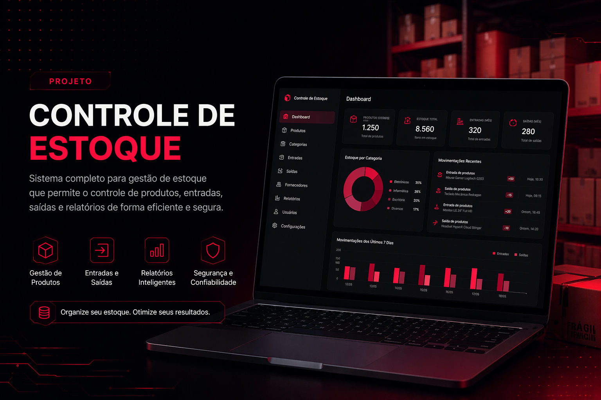

# 📦 StockPro BI - Sistema de Gestão de Estoque



> Sistema de Business Intelligence para controle de inventário, desenvolvido com foco em performance, estética dark premium e usabilidade avançada.

---

## 🚀 Funcionalidades

* **Dashboard em Tempo Real:** Visualização de KPIs como volume total, valor patrimonial e ativos críticos.
* **Gestão de Inventário:** Tabela interativa com suporte a cadastro, edição e remoção de ativos.
* **Gráficos Inteligentes:** Análise visual de alocação por categoria e volume por SKU através do Chart.js.
* **Relatórios Executivos:** Geração de arquivos .CSV para integração com Excel e outras ferramentas de análise.
* **Persistência de Dados:** Armazenamento local via LocalStorage (os dados permanecem salvos mesmo após fechar o navegador).

---

## 🛠️ Tecnologias Utilizadas

* **Frontend:** HTML5 e CSS3 (Custom Properties & Glassmorphism)
* **Lógica:** JavaScript ES6+
* **Gráficos:** [Chart.js](https://www.chartjs.org/)
* **Ícones:** [Lucide Icons](https://lucide.dev/)
* **Design:** UI Dark Mode com paleta voltada para sistemas corporativos de alta performance.

---

## 💻 Como rodar o projeto

1. Faça o clone do repositório:
   ```bash
   git clone [https://github.com/theusms67/Controle-de-Estoque]
   Abra o arquivo index.html diretamente no seu navegador.

📄 Licença
Este projeto foi desenvolvido para fins de portfólio acadêmico e profissional. Sinta-se à vontade para explorar o código!

Desenvolvido com ⚡ por Matheus Macedo
